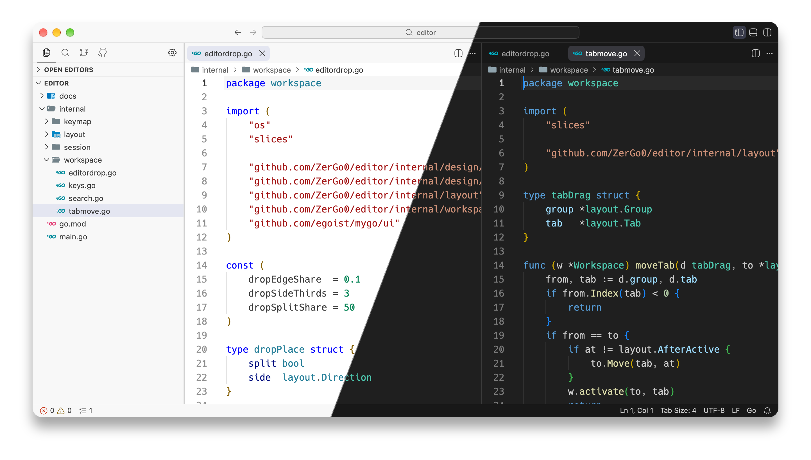

# Editor

A native macOS code editor written in Go with [MyGo](https://github.com/egoist/mygo). It follows the VS Code workbench and adds ideas from JetBrains IDEs.



## Features

- Split editors with VS Code tab drag and drop
- Search Everywhere (press Shift twice), Go to File and Find in Files with multiline queries
- VS Code default keybindings, plus an import of your VS Code keybindings
- Git source control, multi-file diffs, and GitHub pull requests and issues
- Local history, hot exit for unsaved files and Open Recent
- Light, dark and system themes

## Build

Needs macOS on Apple silicon and Go 1.27.4 or later.

```sh
go tool mygo build
open build/darwin-arm64/Editor.app
```

## Develop

The [Taskfile](Taskfile.yml) lists the common commands:

```sh
task dev       # run with live reload
task check     # vet, format check and unit tests
task test:e2e  # end-to-end tests against a built app
task preview   # capture docs/preview.png again
```

Read [AGENTS.md](AGENTS.md) and [docs/design.md](docs/design.md) before you change the UI.
